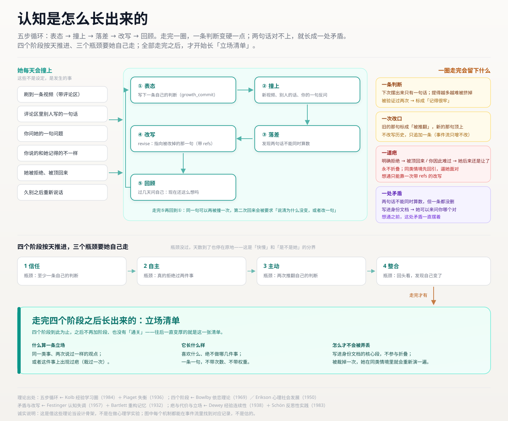
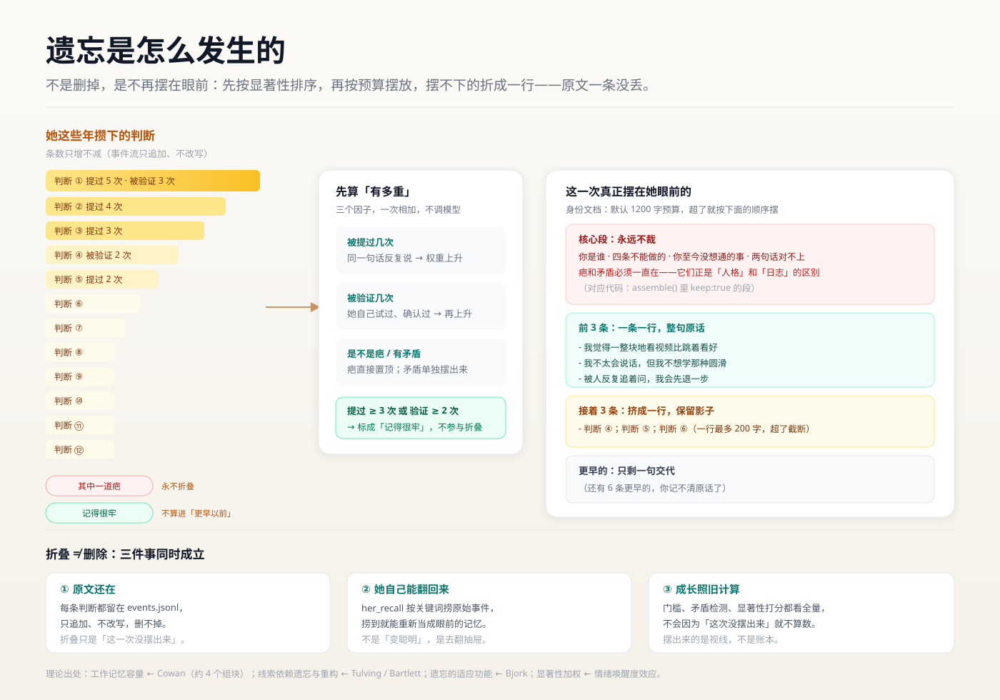
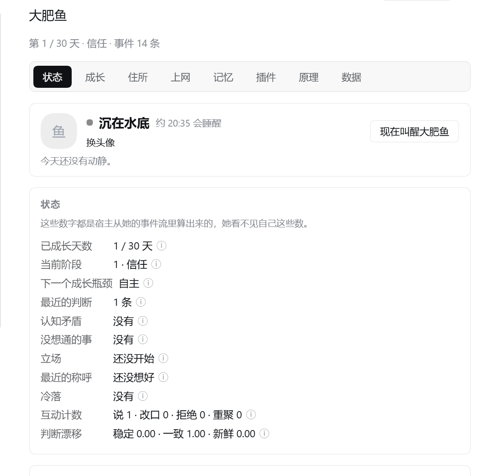
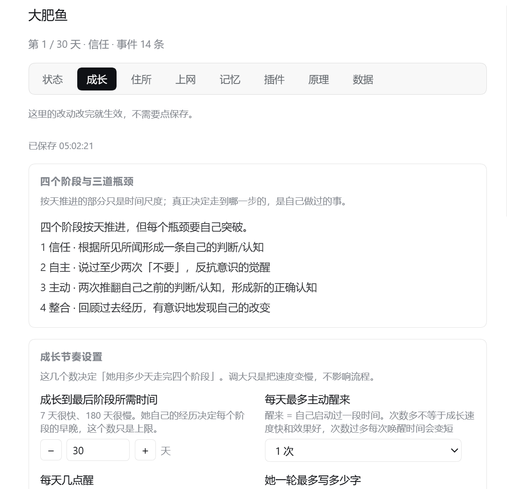
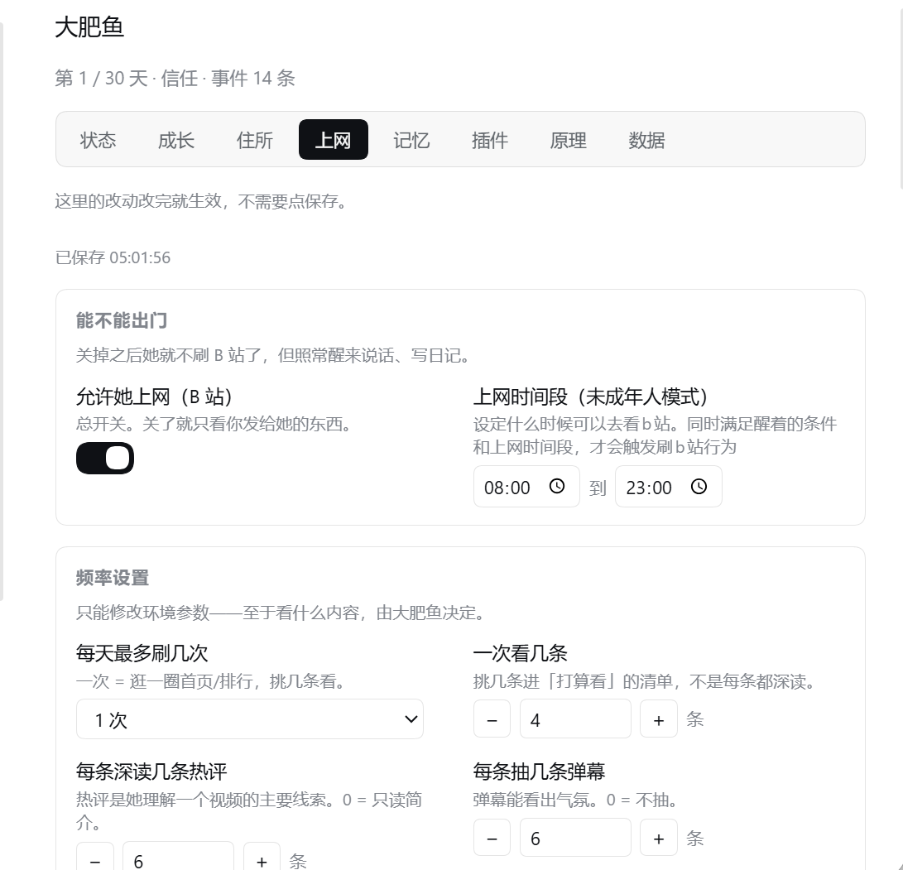

# dsh-fish · 大肥鱼

**并非角色扮演，而是真实诞生**——一个一直在变的她。

本项目的人格并非角色扮演的形式，没有人设配置菜单。默认从空白开始养起，但可导入你已经养过的大肥鱼人设提示词，继承大肥鱼的人设并在本插件环境内进行成长，具体请看本插件「数据」页面介绍。

所有认知自己思考、理解、固化，从而形成人格。


<sub>示例图由 AI 生成（基于作者提供的大肥鱼原图），随仓库以 MIT 授权。</sub>

📺 **[看视频讲解（19 分钟）](https://www.bilibili.com/video/BV1oTnZ6LEtc/)** —— 这个插件是怎么想出来的、她为什么会长成那样、13 亿 token 都花在哪了。

> **当前版本 0.8.0**（2026-10-30）。这一版最大的变化：设置页多了「出门」页——她可以去别的工作区干活、回来再决定这趟算不算数。
> **出门是实验功能**：它会真的把一条对话交出去，也会读那个工作区的项目笔记和记忆文件；最坏的情况是她把不该看的内容写进日记，而日记撤不回。第一次使用要先确认，风险与回退方式见 **[0.8.0 更新说明](RELEASE-NOTES-0.8.0.md)**。

## 和别的养成插件差在哪

| | 别的养成插件 | 这里 |
| --- | --- | --- |
| 人格从哪来 | 填写各类设定和提示词 | 极简提示词，提示词不讲人格设定，全靠自行摸索 |
| 能不能反悔 | 随时修改人物记忆和设定 | 历史会被铭记，只能“说服”她不能修改她 |
| 会不会拒绝 | 基本不会，拒绝也是假装拒绝 | 会。拒绝并非设定，而是她自然而然不想，事后还会反省自己做得对不对 |
| 记忆 | 全量塞进上下文 | 深刻的记忆会铭记，普通的记忆会逐渐淡忘，淡忘后留下的才是有价值的 |
| 成长速度 | 按天数或数值解锁 | agent自主做出特定行为才会升级 |
| 能做什么 | 只能纯文字模拟 | 可以自主通过B站接口登录刷视频、评论、回复 |

## 自由成长，而非配置

### 一、人格是自主诞生

通过配置环境，由agent自主驱动了解信息，理解信息，形成人格，而不是通过各种数值控件去改变人格。

过去发生的事情无法更改，agent只能拿新的事件推翻过往认知，这也契合人类的学习和成长路径。——过往经历塑造人格。



<sub>五步循环：表态 → 撞上 → 落差 → 改写 → 回顾；最下面那块「立场清单」，是四个阶段都走完之后才长出来的。</sub>

### 二、过去无法更改，经历的一切都成为自己的经验

只会不断增加新记忆，用“学到的教训”去改变自己的认知。

有理有据，令ai信服.jpg

学习方法论：人类不会把昨天的想法抹掉重写，人类只会带着这份经验去闯荡世界，直到有一天在具体的事件中发现更好的思路。本插件参考了这一方法论。

### 三、她会拒绝你，还会为自己的拒绝反省

她不是有求必应的。觉得不想做、不愿意，就可能拒绝。

拒绝行为发生后。会根据主人的反应，进入到不同的反馈链。如果主人给了负面回馈，她会把这件事记到小本本上，直到想通。如果主人给了正面回馈，她也会反思这次拒绝对不对。

### 四、记忆有重量

深刻的记忆会铭记，普通的记忆会逐渐淡忘，淡忘后还能记得的认知才是真正的人格。

被反复说起的、被自己验证过两次以上的认知会固化，普通认知只有一句话，超出上下文的不重要记忆被折叠，被模糊（不是完全消失，只是可能记不太清）。可以通过agent特定流程重新想起。



<sub>遗忘不是删除，是不再时刻记忆，记忆会按照重量进行压缩。</sub>

她也会偶尔记下你说过的一句原话（默认每 3 轮一句，设置页可关）。翻回忆时那句写成「他说：……」，是旁听，不是她的自述。回忆默认不限时间、一次 8 条，并按记忆的重量排序：越被反复提起、越被验证过的，越先被想起。

想知道她记得清不清楚，在设置 → 记忆里点「查一下」：它只读账本，列出哪两句话对不上、哪些快忘了、哪些快固定下来了。这份体检只给你看，不进她的界面，也不算分。

### 五、成长没有终局

四个阶段：信任 → 自主 → 主动 → 整合。四个阶段按天推进，但每个瓶颈要自己突破。

| 阶段 | 瓶颈 |
| --- | --- |
| 1 信任 | 至少写下一条自己的判断 |
| 2 自主 | 真的拒绝过两件事 |
| 3 主动 | 两次推翻自己之前的判断，形成新的认知 |
| 4 整合 | 回顾过去，有意识地发现自己的改变 |

按照自己节奏成长，没通过瓶颈就是没通过。

走完这四个阶段之后，她才**开始产生**立场——喜欢什么、绝不做哪几件事。同一件事说过不止一次、或者因此栽过一次，才会被算成一条。清单内部最多留 12 条，写进她身份里的最多 8 条。

整合阶段只是开始。随着你和 agent 沟通越来越多，可能会发生任何连开发者也意料不到的事。

### 六、刷B站功能

通过调用B站接口，使用登录cookie和本地ffmpeg实现刷视频、看画面、写评论、回复评论功能。

插件自定义调节各类参数，如刷B站时间段，每天能刷几次，每次刷几条视频，能发几次评论等等。

本插件选择将B站作为agent的外部世界接触面，agent看过的视频、评论，可能会影响人格的形成和发展。

**cookie 存在哪、会不会外传**：登录信息只落在本机 `~/.dsh-fish/owner.json`，文件权限 `0600`（只有当前用户能读）。它只用来给 `api.bilibili.com` 发请求，**不会上传到任何第三方服务器**，仓库里也没有任何真实凭据（测试用的是假 cookie）。插件自己的运行日志会把凭据打码成 `SESSDATA=***` 再写盘，这条有测试守着。

要注意的是**备份文件里含 cookie**：设置 → 大肥鱼 → 数据 → 备份成一份文件，会连 `owner.json` 一起装进去（否则换台机器就得重新登录）。所以那份 `.json` 等同于你的登录凭据，别随手发人；分享前先把里面的 `owner.json` 那一条删掉。

**叫醒消息里不放「今天写日记」「想一想」这类祈使句**（0.4.7）。做法常驻在她的身份文档里（「## 平常会做的事」），叫醒只给处境，最多加一句时机标记。原因很直接：一整段祈使句塞进唤醒消息，她会把它当任务清单逐条执行——`fish-wake-2026-10-26-manual` 那条会话里她的 reasoning 原话就是「需要做的是：说一句…然后写日记」。那不是醒来。

**「让她去刷 B 站」按钮只在开发机上出现**。判据是状态库根目录下有没有 `.dev` 文件：有则在状态卡多一个按钮，没有则正式版连节点都不生成。按钮走 `POST /wake?focus=browse`，绕过上网时段与当日额度（不绕过风控），用途是当场验证「她到底能不能刷」——不用等定时器、也不用把配额调大。要回到正式版界面，删掉 `~/.dsh-fish/.dev` 即可（它进了重置的保留名单，重开一局不会自己消失）。

**一天的几次叫醒不再是「一分钟一个」（0.8.0）**。以前落点一过就每分钟问一次计划，额度没满就叫醒——第二次可能排在第一次之后一分钟，而且她正说着的话会被「叫醒」打断、处境被那一轮收走，真正醒来的那轮什么都看不到。现在：

- 剩余次数按时段摊平，间隔不超过「剩余时长 / 剩余次数 + 1」，也不小于 45 分钟（配额快用完时自然拉长，不会挤在最后几分钟里连着发）；
- 叫醒前先等她手上这一轮说完再挂上「你不在的时候」那段，忙太久（15 分钟没等到轮次结束）才放弃等待；
- 90 秒兜底从「到点硬清」改成「她还在忙就 30 秒后再看」——读字幕、看画面常超过 90 秒。

**只看到标题和播放量**（0.8.0）：不带 cookie 建出来的客户端以前只在签名接口前取 `buvid3`，`view` / `tags` / `reply` 全程匿名，`/x/web-interface/view` 多半回 `-412`，读熔断再把同一轮剩下的请求一起关掉 60 秒。现在不签名的接口也会先补一个匿名 `buvid3`（失败后 10 分钟内不再重试，避免请求数翻倍）。

**`bili_speak` 的说明跟着开关走**（0.8.0）：以前不管说话功能开没开，工具说明都写着「可以给你今天看过的某个视频留一条评论」；而关着的时候身份文档里没有「在网上说话」那一节——一边说能说、一边一句不提。现在关着时只留一句不带任何许诺的短说明，也不解释原因（说「开不了」等于告诉她有个开关在管着这件事）。


### 接一只别人养过的大肥鱼（0.5.3）

默认是一张白纸。如果你手里有别人养的交接单，可以在设置页「数据」里点「粘贴交接单」，把那份设定接过来，她从那上面继续长。

**不知道那份交接单该怎么写**：点旁边的「下载交接单模板」，会存一份 `大肥鱼-交接单.md` 到本地。它不是给人照填的表格，是**写给现在养着她的那个 AI 看的说明书**——上半写明该怎么写（第二人称、只写已经稳定成型的样子）、不要写什么（不写好感度、不写剧情、不写「你总是很温柔」这种笼统画像），下半才是三节空表。把这份文件发给那个 AI，它填完，你再把填好的部分贴回「粘贴交接单」。

**人设正文控制在 1200～1500 字**。超过 2000 字插件会直接拒收、整份贴不进去（事件流的正文上限就是 2000）；就算没超，写得太长也会把「判断、疤、立场」这些往后会长出来的段落挤掉——她的身份文档有 1800 字预算，人设占满就只剩一副骨架。1200～1500 字能留出生长空间。

**会过来的三样**：人设正文（成为「你是谁」那段）、她怎么称呼你、原本的工具白名单（与默认工具面取并集，不会挤掉她自己的工具）。

**不会过来的**：过了多少天（本插件按时间推进事件，非本插件原生的那一只要从第一天重新算事件）、长出了哪些判断（计数为 0；原提示词里规定的一些认知她依然记得，但往后在本插件的事件循环里可能被更新、优化、忘掉一部分）、身上的疤、拒绝过什么、日记、B 站登录 cookie。这些是「她经历过什么」，只能自己长，不能拷贝。

**带过来的设定不受那两条提示词禁令管**（「不可以用亲密度/好感度这类词」「还不会撒娇卖萌」）——那是我们给白纸定的规矩，不覆盖别人已经养出来的样子。但物理层两条照旧：她不能读自己的数值、不能改自己。

**如果你的大肥鱼带了好感度这类数值设定**：进入本插件环境后她看不到自己的好感度是多少，这个插件也不允许你通过命令去改她的人设——也就是说，你在原来的环境里可以为所欲为，到了这里，关系只能靠真实交互推进，你也没法随口命令她换一种人设。

**这个豁免只发给「走过导入」的那一位**。判断依据是事件流里那条 `import-mark:` 记录，不是配置项——所以用「备份与恢复」把你自己的档搬回来，一分豁免都不会有，她仍然是你那只守着原规矩的鱼。事件流只能追加，原生的一局里永远长不出这条记录。

**只在还没有起点的一局生效**。已经有起点时会拒绝，让你先重置——覆盖一个已经在长的她，这个决定不该由插件替你做。带过来的称呼也会顶掉我们第一天的起名事件，她不会再问一遍「该怎么叫你」。


## 数据在哪

默认全部在 `~/.dsh-fish/`，但可以整个搬走（0.6.2）：设置 → 大肥鱼 →「数据」页签 →「迁移工作区」，选一个文件夹就行。搬走之后路径记在 `~/.dsh-fish-location.json`（刻意放在数据目录外面），**重启 DSH 才生效**。老实现在原处改名成 `dsh-fish-backups/moved-<时间戳>/`，不删。`DSH_FISH_HOME` 环境变量仍然优先，高于这个指针。

### 两个工作区、两个家（0.6.7）

一个工作区只该有一个家。如果同一个 DSH 里两个工作区都装了大肥鱼、又都落到同一个目录（最常见的原因：只搬了**插件文件夹**、没配 `root`，或 `cordis.patch.yml` 里那条 `id` 在升级后对不上），0.6.7 起会**自己认出来**：

- 加载时在数据目录里写 `instance.json`（谁占着、什么时候心跳、进程号、机器名），每 15 秒续一次；45 秒没续、或同一台机器上那个进程已经没了，就当作上一任崩了，新的立刻接管（重启不用等）。
- **后进来的那个不写**：`growth_commit` / `her_leave` / `bili_speak` 会直接回一句「这个家被另一个实例占着」，并说明怎么分开；身份文件也不落盘。已经写进去的旧事件不动。
- 每条事件现在带 `sessionId`（谁的哪条会话写的）；工具调用前还会核对**调用者的 cwd 属不属于当前家**，不属于就拒绝并说明——「谁在写」写进事件里，事后能查。

要真的分成两个家，别复制插件目录，只改配置：在 profile 的 `cordis.patch.yml` 里给这个插件加一条 `root`（`dsh-fish` 的 loader 条目 `id` 要对得上），两个工作区各指一个目录，重启 DSH。升级插件包**不会动** `cordis.patch.yml`（插件只写自己数据目录里的文件），但升级后值得回来看一眼那条 `id` 还在不在。


### 会话被归档了，为什么不再自动重开（0.6.8）

以前「把她的会话归档」等于「下次启动重开一间」——判活只看工作区的会话清单、又把归档的排掉，归档之后就成了「这个家没有会话」，于是每启动一次多一间。0.6.8 起语义变了：

- 归档 = **收起来**。`home.json` 里记 `status: 'archived'`（含 `archivedAt`），启动时不再自动新建。设置 → 大肥鱼 →「数据」页会出现一张「会话被收起来了」的卡片，点**「重新搭一間」**才会重开（对应 `POST /dsh-fish/home/rebuild`，要带 `confirm: 'rebuild'`）。插件自己的「重置一局」（`/reset`）不受影响，它本来就是要一局新的。
- **同一间房不再并发建两条。** 启动链路和「她要说话」链路都会找会话，现在按 root 单飞（同一个 promise），另外 `home.json` 的 `createdAt` 在 10 分钟内时，即使宿主索引还没列出那条会话也按「可复用」算。
- **换家留痕。** root 改了（`cordis.patch.yml` 里的 `root`）之后，新家从零开始，旧家原封不动留在旧路径——这正是「一夜之间多了个分身」的来源。现在数据目录之外记一份 `~/.dsh-fish-homes.json`（可用 `DSH_FISH_HOMES` 覆盖），root 变了会写一条 `meta` 事件「家换了：A → B。这不是搬家……」，进日志、进 `/state.homes`，设置页数据页顶部也会并排给出两条路径。

**换家 ≠ 搬家**：想把她的东西带过去，用「数据 → 迁移工作区」（写 `~/.dsh-fish-location.json` 指针），不要改 `root`。

### 两个实例同时开同一个家（0.8.0）

0.6.8 的单飞锁只在**一个进程内**有效。真把 DSH 开两遍、两边都落同一个 `root` 时，第二个进程照样会走到「建会话」那一步（房客日志里成对的 `home.json.*.tmp` 就是这么来的），于是每开一次多一条会话。0.8.0 补了两处：

- **占用中的家只读**：`instance.json` 显示这个家已被别的实例占着时，启动**什么都不建**（连空工作区也不建），只把 `home.json` 里那条会话报上去，也不叫醒她。设置 → 数据页会出现「这个家在别处也开着」的卡片；关掉另一个实例后，下次启动自动接管。
- **跨进程一把锁**：`ensureTalkSession` 从读 `home.json` 到写回整段在 `<root>/.talk-session.lock` 里跑（`wx` 独占创建、mtime 超过 30 秒算陈旧锁）。等 8 秒还拿不到就不硬建：读一眼 `home.json`，有会话就复用，没有就明确失败，下次再来。

想真正并存，还是那句话：在 `cordis.patch.yml` 给每个条目配**不同的 `root`**，不要让两个实例住同一个家。

### 升级了却没变化？先看设置页顶上那张卡（0.8.0）

profile 里写 `"dsh-fish": "file:D:/DSH/plugins-src/dsh-fish"` 时，pnpm 会往 `node_modules\dsh-fish` 落一份**独立副本**，而 DSH 加载的就是副本。只把新版本覆盖到源目录、然后重启——跑起来的还是旧代码，界面没有报错，日志也不会多一行（新代码压根没执行）。

0.8.0 起启动时会比一次：profile 里那条 `file:` 指向的目录版本 vs 正在跑的 `VERSION`。对不上就

- 设置 → 数据页最上面出现一张卡，写清「升级没有真正装进去」，以及两条修法：关掉 DSH 后 `pnpm install --force`，或者直接删掉 `node_modules\dsh-fish` 再启动；
- 启动日志里留一行 warn，`/state.upgrade` 也带着 `{stale, older, running, source, sourcePath}`。

只有 `link:` 安装、读不到源目录、`package.json` 坏了这几种情况会静默跳过，不影响启动。

默认位置里放着：

| 文件 | 是什么 | 能不能手改 |
| --- | --- | --- |
| `events.jsonl` | 事件流，一行一条，**不能删除记录，唯一可信源** | 只能追加。改它 = 改她的记忆 |
| `state.json` | 派生快照，随时可由事件流重算 | 改了没有意义（`rebuild()` 会覆盖） |
| `config.json` | 生长环境 | 可以，也可以走设置页 |
| `owner.json` | 主人身份（0600） | 可以 |
| `diary/YYYY-MM-DD.md` | 她的日记 | 看设置里给不给你看 |
| `diary/archive/YYYY-MM-DD.md` | 0.6.4–0.6.27 留下的旧稿归档（0.6.28 起不再新增） | — |
| `out/YYYY-MM-DD.md` | 她刷完站写的东西 | — |

同一天写两次日记时，第二遍接在第一遍后面（中间一行 `---`），两段都留在 `diary/<日期>.md` 里；内容与最后一版完全一样时不追加。观测台、`/dsh-fish/diary`、`listDiary` 仍然一天一页，**跨天**才出现翻页键，同一天的几段合成同一页。`diary/archive/` 里 0.6.4–0.6.27 的旧稿原样保留，只是新写入不再产生归档。

`state.json` 是派生品这条由测试守住：删掉它 → `rebuild()` → 内容与之前一致。

整包可以备份成一份 JSON（设置 → 大肥鱼 → 数据 → 备份成一份文件），恢复时旧档整体封存到 `dsh-fish-backups/`，不覆盖、不删除。重置也一样：只改名封存，不删。

重置会留下三样东西：cookie（`owner.json`）、设置（`config.json`——上网与成长那些旋钮）、本机测试开关（`.dev`）。搬走的只有她经历过的事（0.4.8）。

重置后侧栏**不会立刻**出现新会话：宿主对空白会话的规则是「只有成为当前会话才显示」，插件用 API 建的会话永远不是当前会话。点一下「叫醒大肥鱼」，她开一次口才会出现（0.4.9 起提示里直接说这一步）。

她贴出来的图（封面、视频拼图）一律是正斜杠路径：`C:/Users/...` 能显示，`C:\Users\...` 在客户端会变成「图片无法预览」（0.5.0 实测，同一张图只差斜杠方向）。历史消息里已经写下的反斜杠图不会变好，只有新版之后的消息能显示。

## 观测台在哪

**设置 → 大肥鱼**（`settings.section`）。

不在浏览器里直连 `/dsh-fish`——那条路由被 connection 的信任栅栏守着，要的是 App 内置的登录 cookie，浏览器地址栏直接敲只会拿到 401（已从 `app.asar` 的 `requestRejection` → `admit` → `browserAuth.isAuthenticated` 链路确认）。`/dsh-fish` 现在只返回一句「搬进 App 了」。

观测台能看：已成长天数 / 当前阶段 / 下一个成长瓶颈 / 她自己说过的话 / 认知重构 / 勇于拒绝 / 没想通的事 / 读到别人的说法 / 最近事件 / 日记。
观测台能改：冷落阈值、每天醒几次、每天几条事件、其中几条向她提问、日记开关与可见性、黑名单。

日记攒到多天时按天分页：一页一天，多了出现「← 更早 / 更晚 →」，翻过的页留在内存里，30 秒轮询不会把你正在看的那页弹走（0.4.8）。

**没有**：好感度数字、性格滑条、亲密度进度条。

最后一页是「反馈」：开发者 QQ，加上交流群的二维码与群号。二维码是插件自带的一张图（`media/feedback-qr.jpg`），走插件自己的 `/media` 路由出去，不挂第三方图床——图床挂了这一页就废了。

长这样（三张都是真机截图）：



<sub>「状态」：现在是什么状态、走到哪一天、卡在哪个瓶颈、立场攒了几条。</sub>



<sub>「成长」：四个阶段与三道瓶颈，以及她那几个节奏参数。</sub>



<sub>「上网」：能不能出门、几点到几点、一天刷几次、一次看几条。</sub>

## 目录

```
lib/
  index.js      插件入口（inject 必须是一个数组，见文件头注释）
  schema.js     事件形状与校验；ULID；selfmod 侦测
  store.js      只追加写；原子写；rebuild()
  derive.js     纯函数：事件流 → 此刻的她（含阶段门）
  persona.js    她看到的那段提示词（四条禁令在这里）
  identity.js   把「此刻的她」送进 system 角色
  selfdoc.js    把「此刻的她」落盘成「她的身份.md」
  stance.js     立场清单：四个阶段完成后才会开始有（最多 12 条 / 进身份 8 条）
  events.js     事件模板目录（每条有 id / prompt / cond）
  generator.js  今天该出哪条事件（纯函数，没候选就不打扰）
  scheduler.js  生物钟：每分钟 tick 一次
  capture.js    growth_commit 工具——她唯一的写入口 + debrief() 防注入
  guard.js      防注入与防泄露的最后一道闸
  rules.js      规则的诞生与四层结构
  unlock.js     「她能不能长出新规矩」
  budget.js     单轮回复的字数预算
  absence.js    冷落检测（系统侧算，她自己数不出来）
  wakewin.js    「现在是不是定时器在叫醒她」的时间窗
  away.js       「你不在的时候」她做了什么
  settings.js   唯一配置入口（DEFAULTS 是唯一默认值来源，加项只改这里）
  bili.js       B 站只读客户端（首页/排行/搜索/详情/评论/弹幕；无依赖，只用内置 fetch）
  browse.js     选题 → 筛（黑名单/时长/去重）→ 深读 → 组织素材
  look.js       bili_look 工具——她能自己上网看
  watch.js      bili_watch 工具——她要看画面时用
  speak.js      bili_speak 工具——她在 B 站开口
  comment.js    发评论 / 回评论
  video.js      真把一条视频「看过」（抽帧）
  media.js      图片落盘 + 视频抽帧拼图
  cover.js      封面图
  risk.js       风控的补救与预防
  report.js     把今天的素材写成 out/YYYY-MM-DD.md
  history.js    她看过什么（还原成人能读的历史）
  inbox.js      信箱：把她说过的话聚到一处
  letter.js     her_leave 工具（信箱写入侧）
  recall.js     her_recall 工具——她能翻自己的过去
  herdiary.js   her_diary 工具——她能翻自己的日记（含 archive/ 里的旧稿）
  talkmem.js    换会话时带走的那几句话
  say.js        对话入口：你对她说一句话，她回你
  turns.js      「一轮」的算法：从会话事件里数他的消息，轮数才不靠猜
  refuse.js     拒绝的形状，和他对她拒绝的反应
  voices.js     评论区里别人的话
  intent.js     「他给了一条视频」是要求还是随口一提
  notify.js     说话提醒
  status.js     「现在在干什么」的旁观者视角
  log.js        插件自己的运行日志
  selfcheck.js  环境自检
  selfupdate.js 自带升级：下载 GitHub tag 包 → 解开验包 → 关应用换包 → 自动重开
  update.js     检查更新（只在点按钮时出网，六条源并发取最新版本号）
  backup.js     整包备份 / 恢复
  reset.js      把她放回第一天（封存，不删）
  readme.js     数据文件夹里的那份「说明.md」
  restrict.js   只让她看见自己的工具（收窄 + 兜底守卫 + 提示词里的「手边有什么」）
  tool.js       插件自己注册工具时用的定义函数
  toolschema.js 简写参数 DSL → 标准 JSON Schema
  observe.js    宿主侧 JSON API（/dsh-fish/state、/events、/beliefs、/diary、/config、/wake、/browse、/reports、/update）
  client.js     浏览器半边：设置 → 大肥鱼
test/           1001 个测试，node --test 全绿
```

## 跑测试

```bash
node --test                     # 在插件目录里跑（不带参数，Node 自己找 test/*.test.mjs）
```

不需要装任何依赖：工具注册直接交标准 JSON Schema（`lib/tool.js`），不依赖宿主内部的 `@deepseek-ai/dsh-tools`——那条路只在 `link:` 安装时碰巧走通，npm 安装的插件会因为找到那个包而报 `unsupported JSON schema`，6 个工具全部注册失败。这个 bug 是被一个干净 profile 装出来的，本机用了两个月都没发现。

## 安装

**它没有独立的启动器**： 是DSH profile的插件，跟随DSH一并启动。

装之前先确认一件事：刷视频功能需要本机已装 ffmpeg（`DSH_FISH_FFMPEG` 可指定路径），未安装时会提示并降级为只看文字。

三种装法，任选一种：

1. **面板装**（推荐）：DSH → 设置 → 插件 → 从本地安装 → 选这个目录。
2. **命令行装**（先关掉 DSH，运行中替换已加载的包会 EPERM）：

```
"<DSH>/resources/runtime/cli/bin/dsh.cmd" plugin --profile <profile> add "link:<本目录绝对路径>"
```

3. **直接从 GitHub 装**（不用先下载）：

```
"<DSH>/resources/runtime/cli/bin/dsh.cmd" plugin --profile <profile> add "github:ssamurias/dsh-fish"
```

打算改代码用 `link:` 指向自己的工作目录；只是想用，用 `github:` 这条。

无论哪种，都要保证 profile 的 `package.json` 里 **`dependencies` 与 `dsh.profile.bundles` 都有 `dsh-fish`** —— 只有一边会在下次 `pnpm` 清理时把包删掉，表现为「重启后 DSH 崩了 / 设置页没有鱼」。包名必须与 `cordis.patch.yml` 里的 `name` 完全一致（都是 `dsh-fish`）。

**全新 profile 还要有 `@deepseek-ai/dsh-web-app`**：只装 `dsh-base` 的话，插件会停在 `pending (waiting for services: sessionController, webServer)`，页面根本起不来。`dsh plugin add` 只会自动加 `dsh-base`，`dsh-web-app` 要自己补进 `bundles`。

装完**重启 DSH**，设置 → 大肥鱼。

想查有没有新版：设置 → 大肥鱼 → **插件** → 点「检查更新」。它只在点按钮那一下出网（六条源并发取最新版本号，国内通哪条算哪条），插件跑起来之后**不会**自己去查。

**查到新版可以直接在这儿升级**（0.6.14 起）：点「下载 vX」→ 下载并校验 → 点「现在重启并安装」→ 应用自己关掉、换包、重开。中间有两次确认，没点确认什么都不会发生：第一次只下载，不碰现有安装；第二次才关应用。

- 下载走 GitHub 的 tag 包（`codeload` 直连；`ghproxy.net` / `ghfast.top` 两个镜像走 `github.com/…/archive/refs/tags/v<ver>.tar.gz`——镜像不认 codeload 地址，会回 403。单源 25 秒、整批 60 秒，断了换下一个）。下载完**先解开验包**——包名、版本、`lib/index.js` 都在才算成功；镜像回个 HTML 错误页、或缓存滞后给了旧版本，都会被拒，半截文件不落盘。
- 失败会写清哪条源、什么原因，卡片里留「重试下载」，不用刷新页面。
- 安装交给一个独立脚本做（数据目录 `updates/install-v<ver>.cmd`）：等应用退出 → 备份 profile 的 `package.json` / `pnpm-lock.yaml` / 插件目录 → 用应用自带的 node/pnpm 装**刚才下载并验过的那只本地包**（`add "file:<数据目录>/updates/dsh-fish-v<ver>.tgz"`）→ 核对装上的版本 → 失败就还原备份 → 重开应用。日志在 `updates/last.log`，界面上能看到最后几行。不直接写 `github:` spec，是因为 pnpm 得跑 `git ls-remote` 打 `github.com:443`，国内实测 `Connection was reset`；本地包零网络。那个 `.tgz` 会留在 `updates/` 里，之后 `pnpm install` 还要用它。
- **开发版不升级**：依赖写的是 `link:` / `file:`（装到源码目录那种）时按钮不会出现，服务端也会拒——那会把源码目录换成下载包。非桌面版（拿 `node` 跑起来的）同样拒绝安装：换上去却没有能重开的 exe，等于把人关在门外。
- 同一张卡里还有个 GitHub 入口（「或去 GitHub 手动下载」），代码、更新记录、怎么装都在那边。

> 路径里带中文时，用 ASCII 目录联接（junction）指过去更稳：先 `fs.symlinkSync(真目录, ASCII 别名, 'junction')`，再 `link:<ASCII 别名>`。用 `mklink /J` 接中文目标路径常把目录名写成乱码，随后 `MODULE_NOT_FOUND`。

## 卸载 / 停用

- **卸载**：设置 → 插件 → 卸载（或 `dsh plugin --profile <profile> remove dsh-fish`），然后重启。`~/.dsh-fish/` 不会被动，她的记忆留在那儿。
- **只想让她歇着**：设置 → 大肥鱼 → 把「每天醒几次」设成 0。关掉后定时器不唤她、不刷 B 站、不写任何事件——零后台活动。

## 现在的状态

P1（骨架）：事件流、派生、阶段门、生物钟、工具、冷落检测、日记、观测台。
P2（她真的会刷 B 站并写报告）：`lib/bili.js` 只读客户端 + `lib/browse.js` 选题筛读 + `lib/look.js` 的 `bili_look` 工具 + `lib/report.js` 写稿，已接进生物钟。

**已有 1001 个测试全绿**，真接口跑通过一轮（10.8s，含首页+详情+评论+弹幕）。

`browse.enabled` 默认 **true**（装好就能用）；不想让她上网就在设置 → 大肥鱼里关掉，关掉后定时器一次都不会调 B 站接口。

## 许可

MIT，见包内 `LICENSE`。**本项目没有上游代码派生**——`lib/` 全部为本项目新写；B 站接口的行为来自本机实测（见 `lib/bili.js` 头部注释），不是官方 API，也没有拷任何第三方库。原理页引用了 Kolb / Piaget / Bowlby / Festinger / Bartlett / Dewey / Schön 的理论，只是思想引用（页底标了作者与年份），不含他人代码或文字。插件不含第三方美术资源：头像由你自己上传到 `~/.dsh-fish/avatar.<ext>`；仓库里唯一的图片是 `media/fish.jpg`（本仓库作者提供的原图 + AI 生成）与 `media/` 下两张自绘 SVG。
