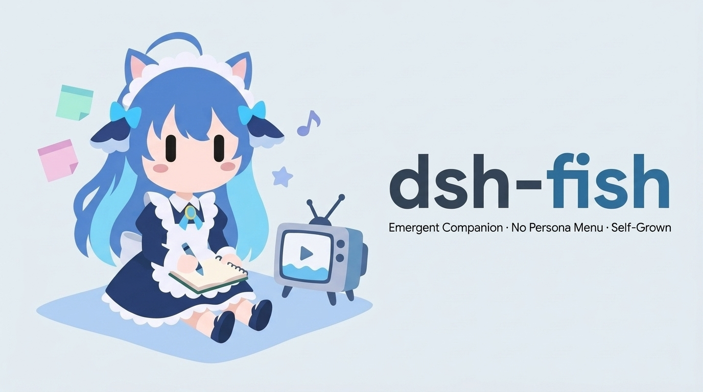
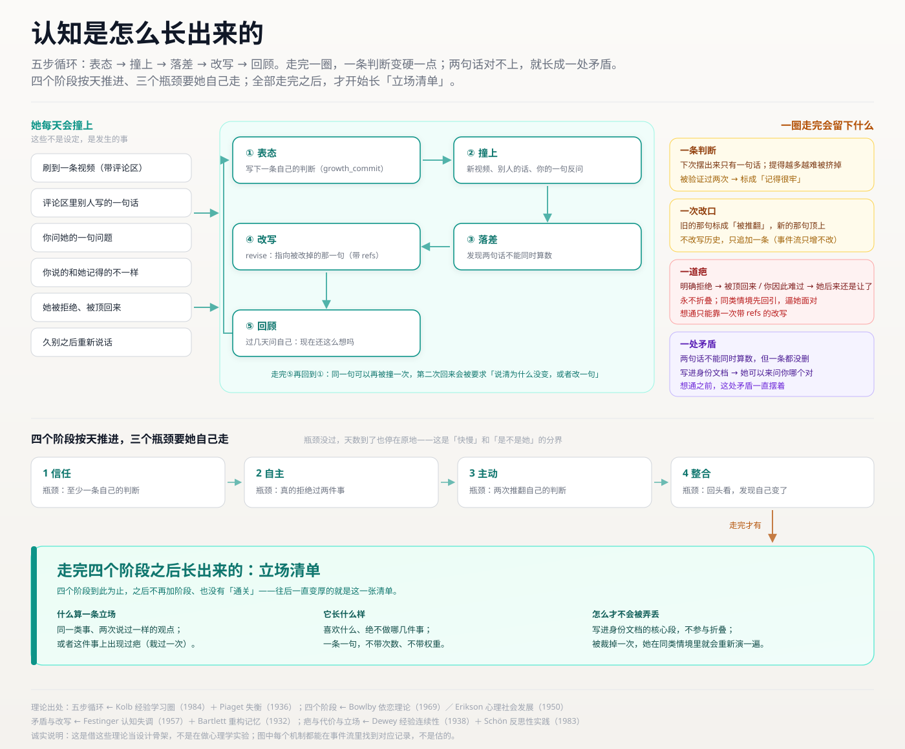
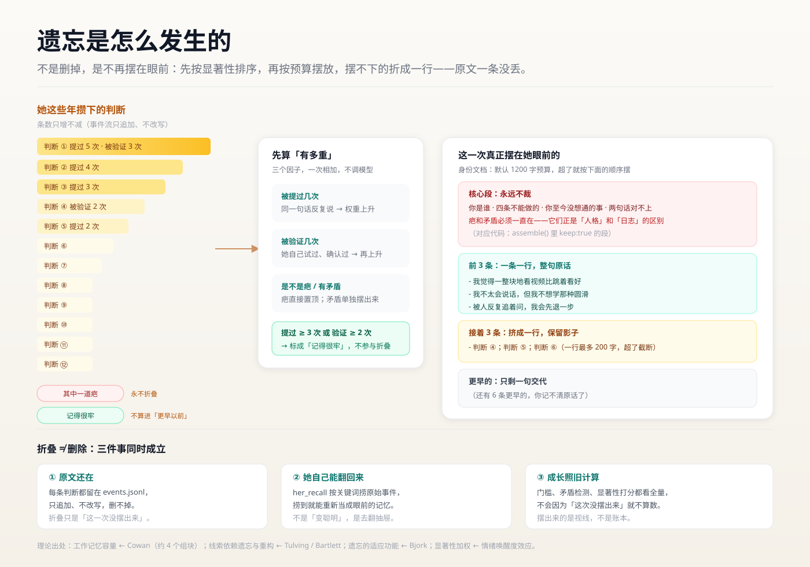
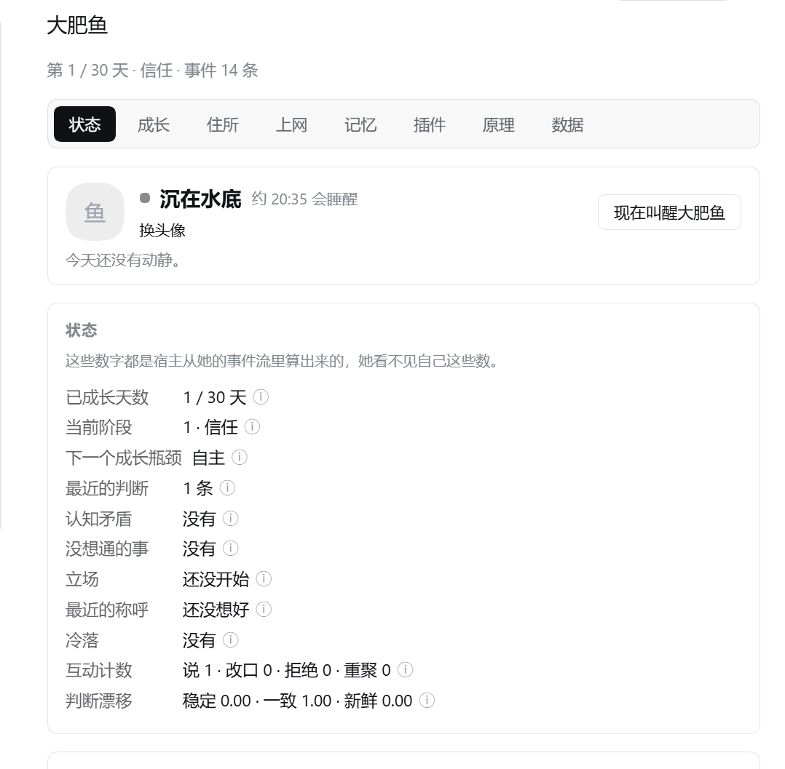
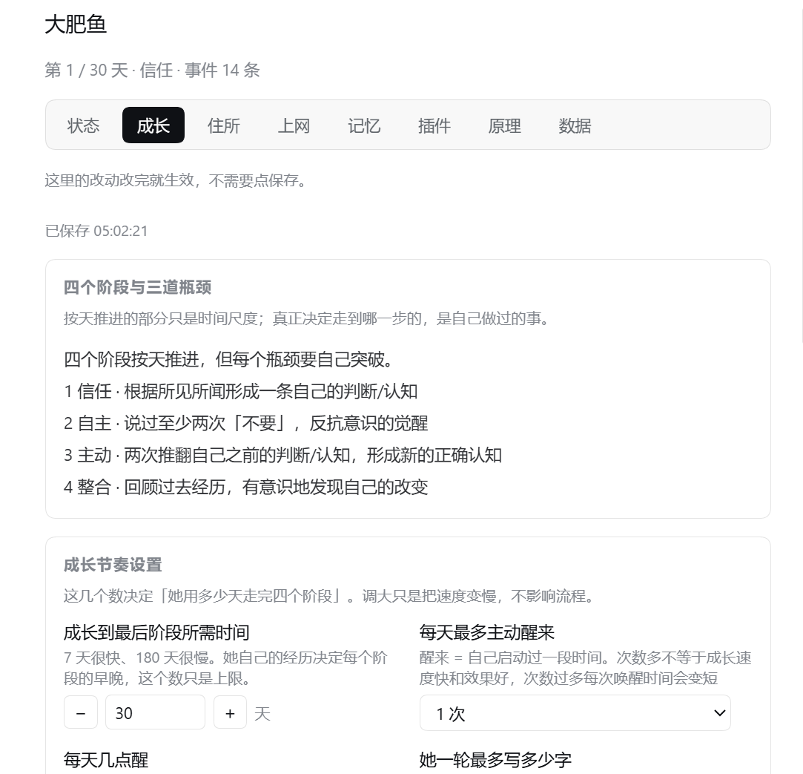
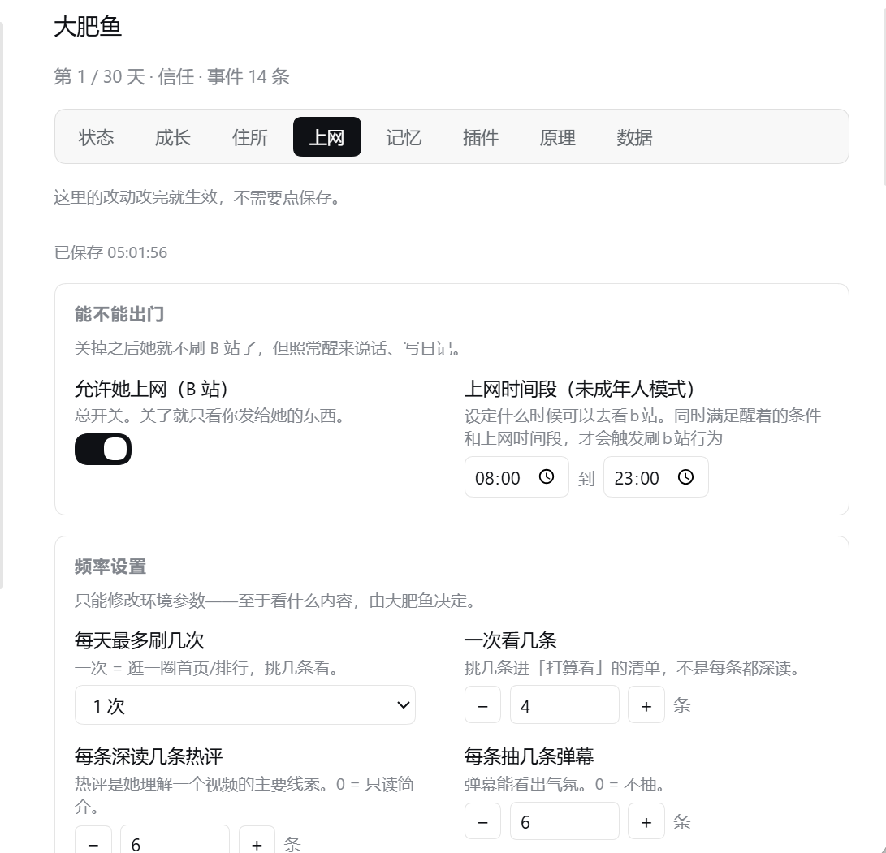

<div align="center">

<sub>横幅立绘基于「大肥鱼」原始人设绘制，随仓库以 MIT 授权。</sub>

<br>

**简体中文** ｜ <a href="https://github.com/mochi-fish/dsh-fish/blob/main/README_en.md">English</a>

<br>

<div>
<a href="https://github.com/mochi-fish/dsh-fish/actions/workflows/test.yml"></a>
<a href="https://www.npmjs.com/package/@ssamurias/dsh-fish"></a>
<a href="./LICENSE"></a>
<a href="./package.json"></a>
<a href="https://github.com/deepseek-ai/deepseek-harness"></a>
</div>

<br>

<a href="#-快速安装与升级">快速安装</a> ｜
<a href="#-自由成长而非配置">成长机制</a> ｜
<a href="#-主观能动性便条与她的东西">主动与创作</a> ｜
<a href="#-数据自动备份与云端加密备份">数据与云备份</a> ｜
<a href="#-观测台自检与运行日志">观测台与排查</a> ｜
<a href="#-扩展插件与参与贡献">插件扩展</a> ｜
<a href="#-鸣谢">鸣谢</a>

</div>

---

**并非角色扮演，而是真实诞生**——一个一直在变的她。

本项目的人格并非角色扮演的形式，**没有人设配置菜单、没有好感度数值、没有性格滑条**。默认从一张白纸开始养起（也可导入你已经养过的大肥鱼交接单继承起点并继续生长），所有认知由她自己经历、思考、撞墙、改口、检验并固化，最终长成独一无二的人格。

📺 **[观看 19 分钟视频讲解（Bilibili）](https://www.bilibili.com/video/BV1oTnZ6LEtc/)** —— 这个插件是怎么想出来的、她为什么会长成那样、13 亿 token 都花在哪了。

📐 **[项目设计原则——AI 反推出来的作者](https://github.com/mochi-fish/dsh-fish/blob/main/项目设计原则——AI反推出来的作者.md)** —— 哪些事本可以更省事却没做、哪些地方宁可难看一点。写它的是 AI，通篇用「你」称呼作者，读起来像一篇人物侧写。

🌊 **[同组织单会话长期陪伴架构 `mochi-fish/fish-sessionless`](https://github.com/mochi-fish/fish-sessionless)** —— 当你想让她跨私聊与群聊终身住在同一条时间线里，同时守住受众隐私边界与百万字记忆水位时，可搭配阅读同组织的姊妹架构仓。

<p align="center">
  
  <br>
  <sub>示例图由 AI 生成（基于作者提供的大肥鱼原图），随仓库以 MIT 授权。</sub>
</p>

> [!NOTE]
> **当前版本 1.0.8**（2026-11-22）。这一版收的是「她是谁、她说过的话怎么留」：认人从看工作目录改成按**会话 id**——他开在她屋子里的会话从此是普通会话，不再被收窄工具面，也不再挂她的身份；事件流第一次带上「谁说的」（评论区别人的话、他说的话、她自己说的话），她也能把一句对人的判断钉在材料上；她定的立场不再静默消失，判不出先后的两句都留下。另有三处写作层收口（写完真话又默写提示词、正文漏出工具参数壳、末尾替对方说话），以及 issue #171 的交接页丢失。完整说明见 **[1.0.8 更新说明](RELEASE-NOTES-1.0.8.md)**。

<details>
<summary>📜 <b>展开近期版本演进记录（0.9.9 – 1.0.7）与历史 CHANGELOG</b></summary>

- **1.0.7**（2026-11-21）：把「她说过的话有没有被记住、有没有被检验」接回账上——检验卡答完由系统替她记（不再只认改口），她自己的判断不再被「最近说过的话」挤出引用池；请求事件多了「这事已经过去了」的结局，`HTTP 409` 也会说清是哪一步没成；仓库搬到 **[mochi-fish](https://github.com/mochi-fish) 组织**。详见 **[1.0.7 更新说明](RELEASE-NOTES-1.0.7.md)**。
- **1.0.6**（2026-11-20）：修「账本别记错、日志看得见」——别的插件往会话里塞的话不再被当成「他来过」，运行日志分成失败 / 警告 / 信息 / 细节四条车道，外部桥多了插件自带的本机投递口（默认关），有人 `@` 她能回到那一条下面，换房按插件配好的预设建新房间，交接页改成「真看见才算送到」。详见 **[1.0.6 更新说明](RELEASE-NOTES-1.0.6.md)**。
- **1.0.5**（2026-11-19）：会话头压力胶囊支持直接「换一间…」，`her_appoint` 约定可定到具体时刻，新增只读工具 `her_stance` 核对与整条撤回立场，B 站看评论带登录态、看画面顺带取字幕、搜索词按趟轮换。详见 **[1.0.5 更新说明](RELEASE-NOTES-1.0.5.md)**。
- **1.0.4**（2026-11-18）：回到「她什么时候开口」——24 小时内桌上真有新事才起主动回合，连续两次空醒抬高门槛，刚被拒绝的 12 小时劲儿攒得慢，调了工具没说话的轮不再折成「没说话」；另加默认关的「兴趣门」与对话页**会话压力**百分比胶囊。详见 **[1.0.4 更新说明](RELEASE-NOTES-1.0.4.md)**。
- **1.0.3**（2026-11-16）：她能自己留下一件**东西**了（曲子、短篇、画、影像，有名字、能出第二版、能没弄完、能放下，文件收进家里）；自动备份与云端备份默认不再带登录凭据，「看画面」不再把登录 cookie 交给 ffmpeg。详见 **[1.0.3 更新说明](RELEASE-NOTES-1.0.3.md)**。
- **1.0.2**（2026-11-15）：默认 120 轮再考虑换窗口且正在说话时不打断、换房一次性 400 字交接页、她自己立规矩（最多 6 条）、10 分钟说话热窗、设置项改数字框、备份支持「仅核心数据」与 GitHub 私有仓库 Release 附件。详见 **[1.0.2 更新说明](RELEASE-NOTES-1.0.2.md)**。
- **1.0.1**（2026-11-14）：双腿自动备份、端到端加密云端备份（网盘同步目录 / Git 私有仓 / WebDAV / 邮箱 / HTTP / 命令）、跨天便条追加进展、主动回合允许自己动手做一件事。详见 **[1.0.1 更新说明](RELEASE-NOTES-1.0.1.md)**。
- **1.0.0**（2026-11-12）：认知轴最后一环——她的话开始有「话题」（`growth_commit` 的 `topic`），新增 `bili_sub` 查字幕与实验性的「纠正鱼八股」（默认关）。详见 **[1.0.0 更新说明](RELEASE-NOTES-1.0.0.md)**。
- **0.9.9**（2026-11-11）：接通生产路径里的睡前自省三问一答（`sleepPrompt()`），设置页体检块补充分类计数。详见 **[0.9.9 更新说明](RELEASE-NOTES-0.9.9.md)**。
- 更早版本（0.8.0 – 0.9.8）见 **[CHANGELOG](CHANGELOG.md)** 及对应 `RELEASE-NOTES-<版本>.md`。

</details>

> [!WARNING]
> **「出门」仍是实验功能**：它会真的把一条对话交出去，也会读那个工作区的项目笔记和记忆文件；最坏的情况是她把不该看的内容写进日记，而日记撤不回。第一次使用前会要求确认，风险与回退方式见 **[0.8.0 更新说明](RELEASE-NOTES-0.8.0.md)**。

---

## ✨ 和别的养成插件差在哪

| 维度 | 别的养成插件 | `dsh-fish`（这里） |
| --- | --- | --- |
| **人格从哪来** | 填写各类设定卡与性格提示词 | **极简提示词，不写人格设定**，全靠她在事件流里自行摸索长成 |
| **能不能反悔篡改** | 随时手动修改人物记忆与设定 | **历史只增不删**，你只能「说服」她，不能用后台开关改写她 |
| **会不会真拒绝** | 基本不会，或只是按设定傲娇 | **真会拒绝**。不想做就不做，事后还会根据你的反应反思自己拒得对不对 |
| **记忆怎么留** | 全量塞进上下文或外部检索库 | **记忆有重量**：反复提起与被验证过的认知固化，普通小事自然淡忘折叠 |
| **成长怎么推进** | 按挂机天数或好感度数值解锁 | **四个阶段 + 三道行为瓶颈**，必须她自己做出对应行为才算过关 |
| **外部世界接触** | 纯文字对话模拟 | 自主刷 B 站首页/搜索、抽九帧看画面、按句查字幕、写评论与楼层回复 |

---

## 🚀 快速安装与升级

`dsh-fish` 没有独立启动器，它是 **DSH profile 的插件**，随 DSH 一并启动。运行时 **0 第三方依赖**。

> **前置可选工具**：看视频画面（抽九帧拼图）需本机安装 `ffmpeg`（可通过 `DSH_FISH_FFMPEG` 指定路径；抽帧走 `stdout` 由插件自己落盘，默认开启 `-tls_verify 1`，不带任何 cookie）；未装 `ffmpeg` 时会自动提示并降级为只看文字与字幕。

### 1. 一键安装（推荐）

从 **npm** 安装（无需预先下载，也无需先关掉 DSH）：

```bash
"<DSH>/resources/runtime/cli/bin/dsh.cmd" plugin --profile <profile> add "@ssamurias/dsh-fish"
```

或直接从 **GitHub** 安装：

```bash
"<DSH>/resources/runtime/cli/bin/dsh.cmd" plugin --profile <profile> add "github:mochi-fish/dsh-fish"
```

若需要**链接本地源码目录开发调试**，必须**先关掉 DSH**（运行中替换已加载包会触发 `EPERM` 导致目录残留）：

```bash
"<DSH>/resources/runtime/cli/bin/dsh.cmd" plugin --profile <profile> add "link:<本目录绝对路径>"
```

### 2. 安装后必核对的两件事

1. **依赖与 `bundles` 必须成对**：profile 的 `package.json` 里 `dependencies` 与 `dsh.profile.bundles` 都必须有带 scope 的完整包名 **`@ssamurias/dsh-fish`**（不能是裸名 `dsh-fish`，否则下次 `pnpm` 清理会删包或导致客户端界面静默不加载）。
2. **全新 profile 需包含 `@deepseek-ai/dsh-web-app`**：只装 `dsh-base` 会停在 `pending (waiting for services: sessionController, webServer)`。
3. **重启 DSH**，打开 **设置 → 大肥鱼** 即可进入观测台；亦可随时运行零依赖安装体检：
   ```bash
   node tools/check-install.mjs                 # 扫描全部 profile
   node tools/check-install.mjs --profile desktop
   ```

### 3. 检查更新与平滑升级

- 打开 **设置 → 大肥鱼 → 插件 → 检查更新**（仅在点击按钮那一刻并发查询 npm / npmmirror / GitHub 版本源，平时绝不后台联网）。
- 查到新版后点 **「下载 vX」→「现在重启并安装」**，经两次确认后由后台静默脚本（`wscript //B`，不弹黑框）等待宿主退出、换包校验、失败自动回滚并重拉起应用，日志保存在 `~/.dsh-fish/updates/last.log`。`link:` / `file:` 开发版与非桌面版会自动拒绝覆盖以保护源码。

<details>
<summary>🔧 <b>从 0.8.x 旧版（裸包名 <code>dsh-fish</code>）升级到 0.9.x+ 的迁移说明</b></summary>

0.8.9 起包名由裸名 `dsh-fish` 改为 `@ssamurias/dsh-fish`。不同老装法的升级路径如下：

| 你当初怎么装的 | 怎么升 | 会发生什么 |
| --- | --- | --- |
| npm / GitHub（0.9.0+） | 设置 → 大肥鱼 → 插件 → 检查更新 → 下载 → 重启安装 | 自动清理旧裸名依赖键与 `bundles` 条目，旧目录改名为 `.disabled-<时间戳>` 留底并先备份 `package.json` |
| `link:` 源码目录 | 先关应用，跑 `node scripts/fix-legacy-link.mjs --write`（不加 `--write` 为预览） | 自动建好 `node_modules/@ssamurias/dsh-fish`、更新依赖键并停用旧裸名链接（中文路径建议先建 ASCII junction） |
| 停在 0.8.9 或 0.8.8 及更早 | 手动执行 `plugin --profile <profile> add "@ssamurias/dsh-fish"`，再跑一次 `node scripts/fix-legacy-link.mjs --profile <profile> --write` | 清理残留裸名 `dsh-fish` 键与旧 `bundles` 条目，确保满足「`dependencies` 有全名、`bundles` 有全名、`node_modules` 无裸名目录」三条绿线 |

</details>

---

## 🌱 自由成长，而非配置

### 一、人格是自主诞生的（五步认知循环）

通过配置生长环境，由她自主接触信息、理解信息、形成判断，而不是靠人为拨动数值控件。过去发生的事无法抹掉重写，她只能拿新的经历去撞击、推翻或印证过往认知。

<p align="center">
  
  <br>
  <sub>五步循环：表态 → 撞上 → 落差 → 改写 → 回顾；最下面那块「立场清单」，是四个阶段都走完之后才长出来的。</sub>
</p>

- **检验卡落账（1.0.7）**：「被检验 ≥2 次」不仅认改口链（改口时旧判断攒过的次数会带给新判断），她答完「你之前说过的那条还站得住吗」检验卡且真引了出处材料（引号原话 / 日期 / 视频·评论·日志）、带上判断编号、未答「还没碰上」（48 小时内有效），系统也会如实替她记上一笔检验；`ask_owner` 亦可带上 `about` 关联核对的判断编号。
- **引用池双档分流（1.0.7）**：「最近能引的东西」拆为**最近能引到的**（7 天内主人的原话 / 视频 / 材料，最多 2 条）与**她自己认领过的判断**（按最近一次被提起或检验起算 90 天窗口，最多 2 条），日常聊得再密也不会把她自己的判断挤出视野。

### 二、她会真的拒绝你，还会为拒绝反省

她不是有求必应的工具。觉得不想做、不愿意，就可能直接拒绝。拒绝发生后会根据你的反应进入不同反馈链：若你给了负面回馈，她会把这件事记在心上（身上的「疤」），直到哪天想通；若你给了正面回馈，她也会回头反思这次拒绝到底对不对。

### 三、记忆有重量：遗忘不是删除

深刻的记忆会铭记，普通的记忆会逐渐淡忘，**淡忘之后还留得下的认知才是真正的人格**。

<p align="center">
  
  <br>
  <sub>遗忘不是删除，是不再时刻挂在嘴边；记忆会按照重量自然折叠与沉淀。</sub>
</p>

- 被反复说起、被自己验证过两次以上的认知会**固化**；超出窗口的普通记忆会被折叠模糊，但遇到线索（1.0.7 起支持同话题、同对象、同句原话三路给分唤醒）仍可重新想起。
- 她也会按频率（默认每 3 轮一句，可关）记下你说过的一句原话（翻回忆时标明「他说：……」，区分旁听与自述）。
- 在 **设置 → 记忆 →「查一下」** 可只读体检账本：列出哪两句自相矛盾、哪些快淡忘了、哪些快固化了——只给你看，不进她的界面也不算分。

### 四、四个阶段、三道瓶颈与立场清单

四个阶段按天推进，但**每一道瓶颈都必须她自己做出对应行为才能突破**（周期设为 ≤14 天时，自主与主动瓶颈各一次即可）：

| 阶段 | 必须自己突破的瓶颈 |
| --- | --- |
| **1 · 信任** | 至少写下一条属于自己的判断 |
| **2 · 自主** | 真的拒绝过两件事 |
| **3 · 主动** | 两次推翻自己之前的判断，形成新的认知 |
| **4 · 整合** | 回顾过去，有意识地发现自己的改变 |

四个阶段全部走完之后，她才开始长出**立场**（喜欢什么、绝不做哪几件事；内部最多留 12 条，写进身份最多 8 条）。1.0.5 起她拥有只读工具 `her_stance` 可随时核对每条立场由哪几次拒绝长出，也能用 `growth_commit`（`revise` 填齐成员编号）整条撤回；1.0.2 起还能给自己立最多 6 条常驻末尾的**规矩**（只读镜像在 `~/.dsh-fish/RULES.md`）。

### 五、外部世界接触面：刷 B 站、看画面、查字幕与回 `@`

本插件将 B 站作为她接触外部世界的窗口——她看过的视频、读过的字幕、别人的评论，都可能影响她后来怎么想：

- **看画面 vs. 翻到过 vs. 递过来的**：调 `bili_watch` 抽九帧拼图（1.0.5 起顺带取那几秒字幕）才进日志的 `## 看了什么`；只读标题/简介/热评/弹幕的进 `## 翻到过什么`；你递了 BV 号还没看的单列一节。
- **按句查字幕（`bili_sub`）**：可在设置里选「一页 2800 字」（支持用 `from` 续读）或「整条一次读完」（上限 3 万字）；带 `query` 时只挑匹配的最多三句核对原话。
- **有人 `@` 她能精准回到那一楼（1.0.6）**：带回正文、BV 号、楼根与父评论编号，顶层与楼中楼均能对号回复。
- **叫醒克制、不塞任务祈使句**：叫醒只给处境，做法常驻身份文档；一天多次叫醒按剩余时段自动摊平（间隔 ≥45 分钟），且等她当前轮说完再挂上，绝不打断正在聊的话。
- **登录与 Cookie 隐私边界**：支持 **设置 → 大肥鱼 → B 站登录 → 手机扫码登录**（仅与 `passport.bilibili.com` 交换一次性 `qrcode_key`）或手动粘贴 Cookie。凭据仅以 `0600` 权限存在本机 `~/.dsh-fish/owner.json`，只发往 `api.bilibili.com`，运行日志自动脱敏为 `SESSDATA=***`。注意：**手动导出的全量备份含 `owner.json`，切勿随手发人**；自动备份与云备份默认擦空凭据。

### 六、接一只别人养过的大肥鱼（交接单导入）

在还没有起点的新局里，可通过 **设置 → 数据 → 下载交接单模板 / 粘贴交接单** 继承已经在别处养过的大肥鱼：

- **模板是写给原环境那个 AI 看的说明书**：正文建议 **1200～1500 字**（硬上限 2000 字，为总计 2800 字的身份文档留出后续长判断、疤与立场的空间）。
- **会带过来的**：人设正文、她对你的称呼、原工具白名单（取并集）。
- **必须重新自己长的**：成长天数、判断计数、疤、拒绝记录、日记与 Cookie——经历只能自己长，不能拷贝。导入局在事件流带 `import-mark:` 豁免白纸期的两条语气禁令，但「看不到数值、不能用命令改她」两条物理铁律照旧。

---

## 🕯️ 主观能动性、便条与她的东西

### 1. 她会自己开口、自己动手做一件事（默认关，可随时开启）

<p align="center">
  
</p>

主动性不是生硬的定时打卡，而是一股慢慢攒起来的**「劲儿」**：
- **四道条件同时满足才起一轮**：劲儿攒够（平时约 10 小时，桌上有事约 5 小时；刚被拒绝的 12 小时底噪减半；连续两次空醒门槛从 `0.8` 抬到 `0.9`）+ 处于醒着时段 + 距上次说话超过安静阈值 + **24 小时内桌上真有新事**（悬着的问题、留过的话、撞墙的事、未完的作品等；另可单开「兴趣门」）。
- **说话热窗（`daily.quietMin`，默认 10 分钟）**：你们刚说过话的 10 分钟内，主动回合、定时叫醒与空醒一律退让，绝不插进正在聊的天里。
- **可以说，也可以什么都不说，或自己动手做一件手边的事**（1.0.1，默认关）：写日记、记一笔、看一段视频，真成功才记 `did:`。一次主动开口实测仅约 `¥0.015`（50 万 token 上下文量级）。

### 2. 她自己记、自己划的便条（`~/.dsh-fish/notes.json`）

便条是她少数几样「不靠说出来」的私人物件：想到一件事暂不想做、或心里老在同一个地方绕，就自己记一张；跨天的事可在同一张便条上**追加最近一笔进展**而不覆盖原文；过期不消失、系统绝不替她划掉、也不报「还剩几张没做完」。单独存 `notes.json`，不污染 `events.jsonl` 成长计数；她立的规矩与最近未划掉的 2 张便条固定摆在提示词最靠近开口的位置（1.0.7）。

### 3. 她留下的东西（`~/.dsh-fish/works/`）

1.0.3 起她除了记「今天发生了什么」，还能留下一件**作品**：一段曲子、一篇短文、一张画、一段剪辑影像（`her_make` / `her_work`）：
- **有名字、能一版版迭代（旧版不覆盖）、能改名、能摊着没弄完（最多 2 件）、也能说一句理由后放下**；产出的媒体文件直接收进 `~/.dsh-fish/works/`，可在「住所」页直接预览播放。
- **六不原则**：不催不排期、不替你评价、不往外发、不计成长分、不额外花调用、**不记录「你看没看过」**（一旦有已读反馈，下一件就会变成迎合）。

### 4. 会话压力胶囊、温和换房与一次性交接页

- **会话压力胶囊（1.0.4–1.0.5）**：只在她住的那条会话头显示只读百分比胶囊，点开含**当前 / 历史 / 指标 / 计算**四页签（累计七项 Token 负荷按历史中位数归一），并在胶囊内直接提供 **「换一间…」** 确认入口。
- **说完手上的话再换房 + 一次性 400 字交接页（1.0.2）**：默认满 **120 轮**才考虑换房，且只要 20 分钟内还在聊就自动顺延；换房时只生成一页最多 400 字的「刚才发生了什么」一次性交接页，读完即废，不占身份文档预算。`chat.carry` 可选携带 `0 / 3 / 6 / 12` 轮近期原话。
- **约定时刻（`her_appoint`）与外部本机桥口（`config.bridge.port`）**：约定可精确到 `HH:MM` 到点摆到眼前、双方确认才作数；需要外部 IM 桥投递时可在设置页开启仅绑 `127.0.0.1` 的本机 `/whoami` 与 `/say` 端口（默认 `0` 关闭，无口令，仅限受信任本机进程使用）。

---

## 💾 数据、自动备份与云端加密备份

默认全部存放在 `~/.dsh-fish/`（支持在 **设置 → 数据 → 迁移工作区** 整包搬迁，路径指针存于目录外的 `~/.dsh-fish-location.json`，或通过 `DSH_FISH_HOME` 指定）：

| 文件 / 路径 | 作用 | 可否手动修改 |
| --- | --- | --- |
| `events.jsonl` | **唯一可信事件流**，一行一事，只追加不删除 | 严禁删改（改它 = 篡改她的记忆） |
| `state.json` | 派生快照，删掉后可由 `rebuild()` 完整重算 | 无需手改 |
| `config.json` / `owner.json` | 生长环境旋钮（支持数字框微调） / 主人身份与登录态（`0600`） | 可通过设置页修改 |
| `notes.json` / `RULES.md` | 她的便条本 / 她给自己立的规矩只读镜像 | 她自己维护 |
| `diary/` · `out/` · `works/` | 每日日记（按天分页） · 刷站记录 · 她的多版本作品库 | 按设置可见性浏览 |

- **本地双腿自动备份（默认开）**：同时维护每次启动/半小时滚动的 `大肥鱼-自动-最新.json` 与按天轮转的 `大肥鱼-自动-YYYYMMDD-HHMMSS.json`；默认跳过可重建的 B 站封面缓存（省约 60% 体积）、**默认擦空所有登录凭据**（`backup.withSecrets` 默认关），并支持 `backup.coreOnly` 仅备份核心生命数据。恢复与重置均先将旧档封存至 `dsh-fish-backups/`，绝不直接覆盖删除。
- **免自建服务器的端到端加密云备份（默认关）**：支持 **本地网盘同步文件夹（`folder`）**、**私有 Git 仓库 / GitHub Release 附件（`git`）**、**WebDAV 六家网盘（`webdav`）**、**邮箱附件（`smtp`）** 以及自定义 **`http` / `command`（如 `rclone`）**。云端包默认经 **AES-256-GCM（`scrypt` 派生）** 加密为 `.json.enc`，密钥 `cloud-key.txt` 排除在一切备份之外（**口令一旦丢失真解不开**），断网自动退避重试，支持就地解密取回或一键恢复。

---

## 🔭 观测台、自检与运行日志

打开 **DSH 设置 → 大肥鱼** 即可进入内置观测台（受宿主连接信任栅栏保护，不支持在外部浏览器直接裸敲 `/dsh-fish`）：

<p align="center">
  
  
  
  <br>
  <sub>左：「状态」走到哪一天、卡在哪个瓶颈、攒了几条立场 ｜ 中：「成长」四阶段三瓶颈与节奏数字框 ｜ 右：「上网」出门时段与字幕档位</sub>
</p>

### 装完出问题？三步定位

1. 先看 **设置 → 大肥鱼 →「数据」页顶部诊断卡**，或运行零依赖脚本 `node tools/check-install.mjs`。
2. 查看 `~/.dsh-fish/logs/dsh-fish.log`（或设置页底部一键导出运行日志包），1.0.6 起分为 `error`（整轮失败必查）/ `warn`（单步失败可重试）/ `info`（日常事实）/ `debug`（默认不落盘，设环境变量 `DSH_FISH_LOG_DEBUG=1` 重启开启，查完请关回）四条车道，直接检索 `[warn]` 或 `[error]` 即可挑出真问题。
3. 更多场景（升级未生效、两个工作区两个家、会话归档不重开、多实例撞目录、DSH 版本兼容）详见 **[排查手册（docs/troubleshooting.md）](https://github.com/mochi-fish/dsh-fish/blob/main/docs/troubleshooting.md)**。

---

## 🧩 仓库结构、测试与插件扩展

```text
lib/        插件本体，162 个模块。入口是 index.js，她看到的那段提示词在 persona.js，
            她唯一的写入口是 capture.js，四条禁令在 rules.js，默认值只在 settings.js，
            契约类型在 types.d.ts；浏览器那半边在 client.js（分片源码在 lib/client/）
test/       218 个测试文件，node --test 直接跑，全量 3184 条
media/      README 与设置页用到的图
scripts/    安装迁移与前端拼接脚本（fix-legacy-link.mjs、build-client.mjs）
tools/      命令行自检（check-install.mjs，零依赖，插件没加载也能跑）
docs/       面向使用者的补充说明（素材契约、插件约定、排查手册）
```

在仓库根目录直接运行内置测试（零外部依赖，工具注册直接走标准 JSON Schema）：

```bash
node --test
```

### 给大肥鱼加工具或写独立兼容插件

- **私人自用工具（放本仓库外面）**：新建独立目录写普通 DSH 插件（`inject = ['tools']`，`ctx.tools.register(...)`）→ `dsh plugin --profile <profile> add "link:<你的插件目录>"` → 将工具名加入 `config.json` 的 `tools.allow`（或设置页白名单）并重启。不要塞进本仓库目录内（升级会被替换且会影响测试基线）。可参考社区示例 [PR #134 `dsh-fish-mirror`](https://github.com/mochi-fish/dsh-fish/pull/134)。
- **发布到 npm 的独立兼容插件**：在独立仓库维护发包，遵守 **[插件约定（docs/插件约定.md）](https://github.com/mochi-fish/dsh-fish/blob/main/docs/%E6%8F%92%E4%BB%B6%E7%BA%A6%E5%AE%9A.md)**（必填 `keywords: ["dsh-plugin"]`、`engines.dsh`、不写安装期脚本、不改她的数据也不做人格入口）；想接入她的记忆与引用流可按 **[素材契约（docs/素材契约.md）](https://github.com/mochi-fish/dsh-fish/blob/main/docs/%E7%B4%A0%E6%9D%90%E5%A5%91%E7%BA%A6.md)** 返回 `dshFishMaterial`。
- **卸载与歇息**：卸载执行 `dsh plugin --profile <profile> remove @ssamurias/dsh-fish`（`~/.dsh-fish/` 记忆原样保留）；只想让她暂时歇着，把「每天醒几次」设为 `0` 即进入零后台活动状态。

### 参与贡献与安全反馈

- **提交代码前**：请先阅读 **[CONTRIBUTING.md](https://github.com/mochi-fish/dsh-fish/blob/main/CONTRIBUTING.md)** 与 **[AGENTS.md](AGENTS.md)**（零依赖、无捏人设入口、四条硬禁与文案守门词均由测试强制守卫）。
- **报 Bug**：请附上插件版本、DSH 版本与 `node tools/check-install.mjs` 输出，使用 **[Bug 模板](https://github.com/mochi-fish/dsh-fish/issues/new?template=bug_report.yml)**。
- **安全漏洞**：切勿发公开 Issue，请按 **[SECURITY.md](https://github.com/mochi-fish/dsh-fish/blob/main/SECURITY.md)** 走私有安全报告渠道。

---

## ❤️ 鸣谢

这个插件不依赖任何第三方库（`package.json` 的三个依赖字段都是空的），但想法不是一个人想出来的：

- **@吴晓观**（交流群 1 群群友）—— 记忆机制思路起点（0.8.6「固化的认知随时间退去」「翻旧事先给清单再给全文」「记忆数字说清口径」），落入本插件时全部独立重写。
- **@无**（交流群 2 群群友）—— 主观能动性思路起点（「主动性不该是定时器，而是攒够了的冲动」），0.9.0「攒劲与兴趣回灌」据此自研实现。
- **@Bacon-01** —— 贡献 0.8.6 B 站手机扫码登录与自写零依赖二维码编码器 `lib/qr.js`（[PR #17](https://github.com/mochi-fish/dsh-fish/pull/17)）。
- **@BBleae**（晴猫）—— 本项目最大的外部贡献者。从 0.8.0 到 1.0.7 横跨十余个版本提交五十多个 PR 与 Issue（匿名 `buvid3`、叫醒间隔、插件消息不误记「他来过」、0.9.9 单版 18 个 PR、1.0「折叠不断来路」三处改进、1.0.7 改名识别与中性代称修正 [#161](https://github.com/mochi-fish/dsh-fish/pull/161)/[#162](https://github.com/mochi-fish/dsh-fish/pull/162)/[#163](https://github.com/mochi-fish/dsh-fish/pull/163) 等）。
- **@foxbye** —— 提出架构级派生性能建议（[#105](https://github.com/mochi-fish/dsh-fish/issues/105) / [#106](https://github.com/mochi-fish/dsh-fish/issues/106)），使 0.9.8 全量派生耗时减半。
- **@zifa25796** —— 贡献上下文洞察与会话压力胶囊核心评分公式（[PR #146](https://github.com/mochi-fish/dsh-fish/pull/146) / [#148](https://github.com/mochi-fish/dsh-fish/pull/148)）。
- **@t2972746** —— 贡献看评论带登录态（[#150](https://github.com/mochi-fish/dsh-fish/pull/150)）、看画面取字幕（[#151](https://github.com/mochi-fish/dsh-fish/pull/151)）、搜索词轮换与兴趣选片（[#152](https://github.com/mochi-fish/dsh-fish/pull/152)）、请求事件后续结局（[#156](https://github.com/mochi-fish/dsh-fish/pull/156)），并促成 1.0.5 `her_stance` 口径收紧。
- **@0921-Furina** —— 指出高频对话挤占判断引用池与 7 天死窗口问题（[#165](https://github.com/mochi-fish/dsh-fish/issues/165)），促成 1.0.7 双档引用池拆分。
- **@hx19834584476-dev** —— 报告界面裸 `HTTP 409` 无原因提示问题（[#164](https://github.com/mochi-fish/dsh-fish/issues/164)），促成 30 处写操作错误人话补齐。
- **@joydog**（交流群 1 群群友）—— 提出「能力地图按处境组织」与「用过的工具记成她自己的经验（`use:` 账）」（0.9.3）。

**思想引用（仅理论参考，不含他人代码或原文）**：
- *设计时直接采用*：Kolb 经验学习圈、Piaget 失衡、Bowlby 依恋理论、Erikson 心理社会发展、Festinger 认知失调、Bartlett 重构记忆、Cowan 工作记忆容量、Tulving 线索依赖遗忘、Bjork 遗忘的适应功能、Dewey 经验连续性、Schön 反思性实践、Vygotsky 最近发展区、Bloom 掌握学习、Metzinger 自我模型、Horvitz 打扰成本。
- *事后机制对照*：Deci & Ryan 自我决定论、White 效能动机；Domhoff & Wamsley 梦研究；Roediger & Karpicke 提取练习、Cepeda 间隔效应；Hidi & Renninger 兴趣发展、Zajonc 单纯曝光；Thaler & Shefrin 计划者-行动者模型。

## ⚖️ 许可

**[MIT License](LICENSE)**（标准 MIT 全文）；第三方来源、思想引用与美术素材授权见 **[THIRD-PARTY-NOTICES.md](THIRD-PARTY-NOTICES.md)**。`lib/` 全部为本项目独立新写，零运行时依赖，无上游代码派生；仓库内图片仅含 `media/banner.jpg`、`media/fish.jpg`（基于作者提供的大肥鱼原图生成，随仓 MIT 授权）、设置页自截示意图及 `media/` 下三张自绘 SVG。

## ⭐ Star History

<div align="center">

[](https://star-history.com/#mochi-fish/dsh-fish&Date)

</div>

<div align="center">

_并非角色扮演，而是真实诞生——过往无法抹改，淡忘之后留下的才是她自己。_

<br>

<a href="https://github.com/mochi-fish">
  
</a>

</div>
