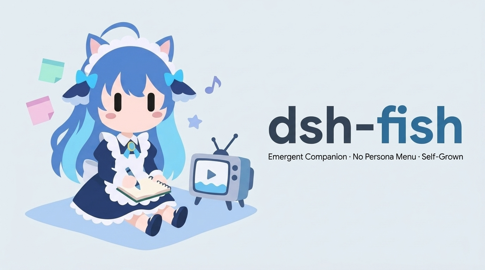
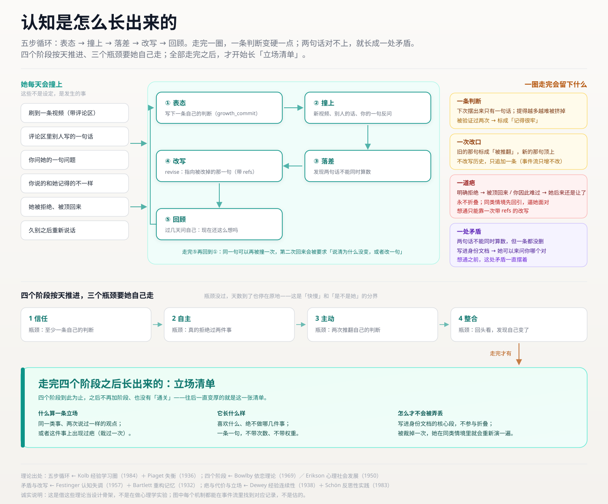

<div align="center">

<sub>Banner artwork generated from the original "Big Fat Fish" character design and released under MIT.</sub>

<br>

<a href="./README.md">简体中文</a> ｜ **English**

<br>

<div>
<a href="https://github.com/mochi-fish/dsh-fish/actions/workflows/test.yml"></a>
<a href="https://www.npmjs.com/package/@ssamurias/dsh-fish"></a>
<a href="./LICENSE"></a>
<a href="./package.json"></a>
<a href="https://github.com/deepseek-ai/deepseek-harness"></a>
</div>

<br>

<a href="#-quick-start">Quick Start</a> ｜
<a href="#-emergent-growth-not-configuration">How She Grows</a> ｜
<a href="#-agency-notes--works">Agency & Works</a> ｜
<a href="#-data--encrypted-backups">Data & Backups</a> ｜
<a href="#-acknowledgments--license">License</a>

</div>

---

**Not roleplay, but genuine emergence** — an ever-changing companion on DSH.

**`dsh-fish`** ("大肥鱼" / *Big Fat Fish*) has **no persona-crafting menus, no affection meters, and no personality sliders**. Starting from a blank slate (or inheriting an imported handover sheet), she browses Bilibili on her own, watches frames and subtitles, keeps private notes, leaves creative works, reflects before sleep, refuses things she dislikes, and forms tested stances through an append-only event stream.

- 📺 **[19-Minute Design Walkthrough (Bilibili, Chinese)](https://www.bilibili.com/video/BV1oTnZ6LEtc/)**
- 📐 **[Design Principles — Author Profile Inferred by AI (Chinese)](https://github.com/mochi-fish/dsh-fish/blob/main/项目设计原则——AI反推出来的作者.md)**
- 🌊 **[Paired Single-Session Companion Architecture: `mochi-fish/fish-sessionless`](https://github.com/mochi-fish/fish-sessionless)**

> [!NOTE]
> **Current Version: `1.0.8`**. This release tightens who counts as her — session id instead of working directory — records *who said what* in the event stream, keeps stances from disappearing silently, and closes three writing-layer leaks (prompt echo, tool-parameter shells, invented lines for the other side). Canonical documentation is maintained in [Simplified Chinese (`README.md`)](./README.md), with per-version release notes in `RELEASE-NOTES-*.md` and [CHANGELOG.md](./CHANGELOG.md).

---

## ✨ How `dsh-fish` Differs from Persona Plugins

| Dimension | Typical Companion Plugins | `dsh-fish` |
| --- | --- | --- |
| **Where Persona Comes From** | Hand-authored character cards & trait sliders | **Minimal blank-slate prompt**; personality emerges from lived events |
| **Can History Be Edited?** | Freely rewrite memories and settings anytime | **Append-only `events.jsonl`** — you can persuade her, never edit her |
| **Can She Refuse?** | Rarely, or only scripted roleplay refusals | **Genuine refusal** followed by self-reflection based on your reaction |
| **How Memory Works** | Stuff everything into context or vector DBs | **Weighted memory**: repeated & verified judgments solidify; trivial turns fade |
| **How Growth Advances** | Timers or XP/affection points | **4 developmental stages & 3 behavioral bottlenecks** she must clear herself |
| **World Contact** | Pure text chat simulation | Autonomous Bilibili browsing, 9-frame video grids, subtitle reading & replies |

---

## 🚀 Quick Start

`dsh-fish` runs inside a **DSH** profile with **zero third-party runtime dependencies** (optional local `ffmpeg` enables 9-frame video snapshots; degrades gracefully to text & subtitles otherwise).

```bash
# Recommended: install from npm
"<DSH>/resources/runtime/cli/bin/dsh.cmd" plugin --profile <profile> add "@ssamurias/dsh-fish"

# Or install directly from GitHub
"<DSH>/resources/runtime/cli/bin/dsh.cmd" plugin --profile <profile> add "github:mochi-fish/dsh-fish"
```

Ensure `@ssamurias/dsh-fish` (full scoped name) is listed in both `dependencies` and `dsh.profile.bundles` of your profile's `package.json` alongside `@deepseek-ai/dsh-web-app`, then restart DSH and open **Settings → 大肥鱼**. Run the zero-dependency health check anytime:

```bash
node tools/check-install.mjs
```

---

## 🌱 Emergent Growth, Not Configuration

<p align="center">
  
</p>

1. **Five-Step Cognitive Loop**: *State → Collide → Discrepancy → Revise → Reflect*. Judgments verified twice (through revision chains or verified check-in cards citing concrete sources) solidify into long-term cognition.
2. **Four Stages & Three Bottlenecks**: *Trust* (write ≥1 judgment) → *Autonomy* (genuinely refuse ≥2 requests) → *Initiative* (revise ≥2 prior judgments) → *Integration* (consciously recognize her own change). Only after clearing all four stages does she begin forming an explicit **Stance List** (`her_stance`) and up to 6 self-authored **Rules**.
3. **Weighted Memory & Forgetting**: What survives fading defines who she is. Built-in read-only memory diagnostics (**Settings → Memory**) surface contradictions and fading entries without exposing scores to her.
4. **Autonomous Bilibili Exploration**: Browses feeds/search, extracts 9-frame video grids (`bili_watch`), reads timestamped subtitles (`bili_sub`), and replies to `@` mentions while keeping credentials strictly local (`~/.dsh-fish/owner.json`, `0600`, masked in logs).

---

## 🕯️ Agency, Notes & Works

<p align="center">
  
</p>

- **Impulse-Driven Agency (Off by Default)**: Instead of rigid cron pings, she accumulates internal drive and wakes only when four gates align (drive threshold, active hours, quiet gap, and genuine new material on the table within 24h), respecting a 10-minute **active conversation quiet window** (`daily.quietMin`).
- **Private Notes (`notes.json`)**: Scratchpad notes she writes, updates with incremental progress, and crosses off on her own — never auto-expired or nagged by the system.
- **Her Creative Works (`works/`)**: Versioned writings, music, drawings, or video edits she chooses to keep (`her_make` / `her_work`), governed by six strict non-gamification rules (no quotas, no grading, no read-receipts).
- **Session Pressure Capsule & One-Time Handoff**: Read-only 7-metric context pressure capsule in the chat header, polite 120-turn room rotation that waits until a conversation pauses, and a single-use 400-char handoff sheet.

---

## 💾 Data & Encrypted Backups

All state lives under `~/.dsh-fish/` (`events.jsonl` append-only source of truth, rebuildable `state.json`, `diary/`, `works/`), movable via **Settings → Data** or `DSH_FISH_HOME`.

- **Dual-Leg Local Auto-Backup**: Rolling `latest` snapshot on boot/shutdown + dated history snapshots, stripping cover caches and scrubbing credentials by default (`backup.withSecrets: false`).
- **Serverless End-to-End Encrypted Cloud Backup (AES-256-GCM + `scrypt`)**: Supports synced cloud folders, private Git repos / GitHub Release assets, WebDAV, SMTP email, custom HTTP, or CLI tools (`rclone`), keeping `cloud-key.txt` strictly outside every backup archive.

---

## ❤️ Acknowledgments & License

Built from scratch in `lib/` with **zero runtime dependencies** (`node --test` runs the full suite out of the box). Warm thanks to community contributors **@吴晓观**, **@无**, **@Bacon-01**, **@BBleae**, **@foxbye**, **@zifa25796**, **@t2972746**, **@0921-Furina**, **@hx19834584476-dev**, and **@joydog** — see [README.md](./README.md) and [THIRD-PARTY-NOTICES.md](./THIRD-PARTY-NOTICES.md) for detailed credits and cognitive psychology references.

Licensed under the **[MIT License](./LICENSE)**. Security issues: please report privately via **[SECURITY.md](https://github.com/mochi-fish/dsh-fish/blob/main/SECURITY.md)**.

<br>

<div align="center">

_Not roleplay, but genuine emergence — what remains after forgetting is who she truly is._

<br>

<a href="https://github.com/mochi-fish">
  
</a>

</div>
